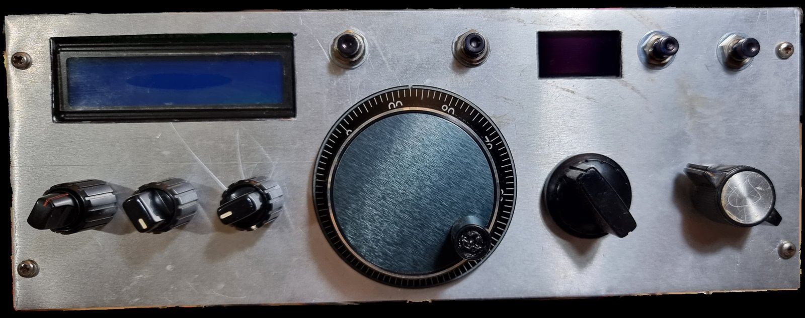

# Atlas 210X — Si5351 VFO, CAT, DSP filter control, RX front end and front plate

Restoration and modernisation of an **Atlas 210X** HF SSB transceiver (1970s) by **YT3CT** (ex YU5KBM).

The original VFO and carrier oscillator are replaced by an **Si5351** controlled by an **Arduino Nano**
with a 16×2 LCD, encoder tuning, band switch reading, a calibrated digital S-meter, CAT control and a
built-in calibrator. A second Nano controls a **SOTABEAMS VariBeam** audio DSP filter with its own OLED
and keys the radio for data modes. A new 3D-printed front plate holds both displays, a CNC-style
tuning knob (MBL600) and extra buttons and rockers. In the radio: a home-made ATT / PRE board, an AGC
fast / slow switch, a data audio interface and PA maintenance.

## Background

I bought this Atlas 210X in semi-working condition, hoping to restore it. A few new capacitors were
enough to get it going: power output, receive and transmit all tested fine. But the radio drifted
quite a bit, and that changed the plan. Instead of a plain restoration it became a full modification
project: replace the VFO with an Si5351, then improve whatever else could be made better.

## Repository layout

| Folder | Contents |
|---|---|
| [`firmware/atlas_vfo_fixed`](firmware/atlas_vfo_fixed) | VFO Nano sketch (current) |
| [`firmware/VB_LocalDisplay_fixed`](firmware/VB_LocalDisplay_fixed) | VariBeam DSP control Nano sketch (current) |
| [`firmware/original_2023`](firmware/original_2023) | The 2023 versions, for reference |
| [`3d`](3d) | Front plate STL (original and corrected) + Python scripts used to measure and fix it |
| [`docs`](docs) | Build notes and measurements (`status.md`), wiring sheet, system and controls wiring, ATT / PRE board (schematic, PCB plan, assembly drawing). Each as PDF + HTML, `*_dark.pdf` for the screen; `build_pdfs.py` rebuilds them. LCD layout mockup (`lcd_mockup.html`) |
| [`tools`](tools) | PowerShell helpers: upload when avrdude fails, serial reader, bootloader check, flash backup; 2023 firmware backup |
| [`photos`](photos) | Build photos |

## VFO Nano (`atlas_vfo_fixed.ino`)

Board: Arduino Nano, **ATmega328P (Old Bootloader)**. Libraries: Etherkit Si5351, LiquidCrystal.

- **Si5351:** CLK0 = LO (RF ± IF) on PLLA with an even integer divider chosen away from the PLL spur
  points, CLK1 = BFO / carrier on its own PLLB (5.520 MHz crystal filter), CLK2 = calibrator.
- **Calibration:** Si5351 crystal ~101 ppm high, corrected in the menu (CORR in ppb) or with AUTO CAL.
- **I²C timeout** (`Wire.setWireTimeout`): an RF glitch on SDA/SCL can no longer freeze the VFO;
  the Si5351 is programmed again and a `!` is shown on the LCD.
- Own quadrature decoder for the MBL600 encoder (one step per detent), tuning acceleration, band
  switch with hysteresis, last frequency per band, frequency saved in EEPROM, RIT removed on TX.
- **CW:** S3 in CW (sensed on A7) moves the carrier 800 Hz into the filter passband. **MODE** rocker =
  opposite sideband.
- **Digital S-meter:** differential reading of the Atlas S-meter bridge (PC-100 pins 15/16 → A1/A0
  through 10 k + 100 nF), calibrated with a tinySA from S6 to S9+40. Normal: bar S1…S9, then
  `+10`…`+40`. With S3 in **CAL** the line shows the level in **dBm**.
- **CAT:** Kenwood TS-480 subset (FA FB IF MD ID PS AI FR FT SM TX RX) at 4800–38400 baud; tested with
  MSHV. CAT TX raises D13 → the VariBeam Nano keys the PTT relay.
- **Calibrator (CLK2):** with S3 in CAL, a short MENU press turns the marker on / off (`MRK` on the
  LCD; always off at power on). The marker sits on a fixed point near the dial: start / middle / end
  of each band, and is injected at the ATT / PRE board input through a shielded attenuator box, so it
  also checks ATT and PRE.
- **AUTO CAL** (menu): CLK2 at 2.5 MHz counted on D5 (Timer1) between the 1PPS pulses of a GPSDO
  on D6, correction applied and checked once more (±0.1 ppm).
- **Setup menu:** hold MENU 1 s (or STEP at power on). Items: BFO, CORR, OPP offset, CW offset, start
  step, acceleration, CAT on / off, CAT baud, CAL level, CAL marker, AUTO CAL. Hold STEP 2 s = save
  and exit, hold MENU 2 s = exit without saving.
- Serial debug (CAT off, 19200 baud): `?` = one status line, `D` = continuous lines, `M` = CLK2
  output pin on / off (leak test).

## VariBeam DSP control Nano (`VB_LocalDisplay_fixed.ino`)

Based on KG4RUL's VariBeam local display sketch (MIT licence, header kept).
Libraries: Adafruit GFX + Adafruit SSD1306 (0.96" OLED).

- Fixed: emulated encoder states now held 2 ms (the VariBeam missed steps), counted detents,
  OLED reset pin clash with the encoder switch.
- Splash screen and **resync at power on** (VariBeam driven to its minimum, then to the saved values),
  settings saved in EEPROM, passband edges + trapezoid passband graph.
- Button: 1× CF/BW, 2× preset (SSB / SSB NARROW / CW), 3× screen when idle (OFF / DIM /
  ALWAYS ON — OLEDs make RF hash even when idle), hold 2 s = resync.
- **CAT PTT:** D8 (from the VFO Nano D13) must stay HIGH for 300 ms before D9 keys the PTT relay
  (bootloader blinks are ignored); 3 min TX timeout with `TX TIMEOUT` on the OLED.

## Radio work (summary)

See [`docs/status.md`](docs/status.md) for all measurements. Highlights:

- **Receiver:** dirty DC switching relay (PC-100) cleaned — big gain improvement. Old tantalums
  replaced on PC-200 / PC-300D; AGC threshold (R309) and S-meter zero (R222) as multi-turn pots.
- **ATT / PRE board** (home etched, in the RX line after the PC-800C): ~17 dB π-pad and a BFG135
  feedback preamp (~+8 dB), Finder relays switched by a front rocker. The preamp runs from a 78L08
  and is only powered in PRE (BD140 switch); 1N4148 clamp diodes at its input.
- **AGC fast / slow:** a BC547 on PC-300D switches the 22 µF AGC hold capacitor; FAST leaves
  2.2 µF (about 11× faster release), the S-meter calibration is unchanged.
- **Data interface on J4** (old EXT OSC socket): TTL serial (CAT and uploads), RX / TX audio through
  600:600 transformers, PTT relay that keys the radio and switches the mic input to PC audio.
- **PA (PC-500D):** cleaned, new thermal paste, the lifted bias resistors refitted, bias diode
  replaced; idle ~1.09 A on TX. 80–15 m 75–100 W; 10 m low (~40 W), to be checked.
- Front panel gain pots replaced (AF / RF, MIC / ALC as concentric pairs) with value compensation.

## Front plate (3D print)

[`3d/Atlas 210 - final.stl`](3d) — 239 × 88 × 9 mm, ready to print (`Atlas 210 - original.stl` is the
first design for comparison). Corrected from the original design:

- **MBL600** 60 mm encoder: recess Ø61.8, through hole Ø44.4, 3 × Ø3.8 at 120° on PCD 50.8.
- **2 × 0.96" SSD1306 OLED**: window 23 × 12, pocket 27.8 × 28.4.
- **16×2 LCD**: window 65 × 15 (pocket as designed, PCB flush with the top edge).

## Wiring

- [`docs/wiring_A4.pdf`](docs/wiring_A4.pdf) — the wiring sheet (3 × A4): LCD, TTL leads, Nano pin use,
  buttons on A6, S3 sense on A7, ATT / PRE, AGC fast / slow, gain pots, J4, calibrator, data audio
  and PTT relay.
- [`docs/system_wiring.pdf`](docs/system_wiring.pdf) — one A3 overview of all blocks and connections.
- [`docs/controls_wiring.pdf`](docs/controls_wiring.pdf) — buttons, rockers, relays and sense wires.
- [`docs/preamp_bfg135.pdf`](docs/preamp_bfg135.pdf), [`attpre_pcb.pdf`](docs/attpre_pcb.pdf),
  [`attpre_assembly.pdf`](docs/attpre_assembly.pdf) — the ATT / PRE board.

## References (not included here)

The Atlas 210X/215X user manual / schematics and the *Atlas 210X/215X Engineering Supplement*
(ZL1UJG / W7KEC) were used heavily. They are copyrighted documents and are not part of this repository.

73 de YT3CT
